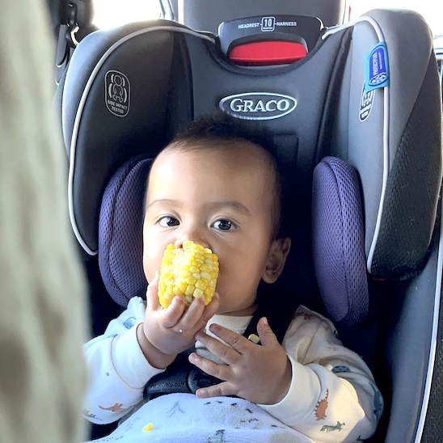
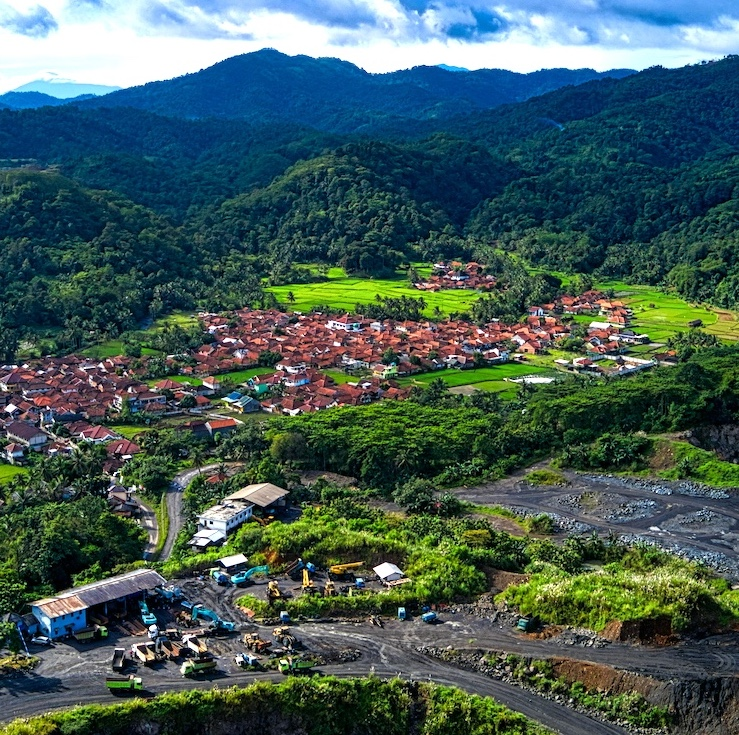

# Research: Building AI We Can Trust

Picture a self-driving shuttle in rush-hour traffic with your children in the back seat. Picture AI helping doctors make split-second decisions in the emergency room, or deciding where and how we source the minerals and energy behind the clean energy transition. In each case the stakes are high, and trust becomes everything.

My research asks a practical question. How do we produce evidence that an AI system is safe enough to deploy, when the failures that matter most are too rare to observe in ordinary testing? An autonomous vehicle would need to drive billions of miles before road testing alone could show that it is safer than a human driver. We need methods that find and quantify rare failures before deployment, with guarantees that engineers, regulators, and the public can check.

I am an Assistant Professor of [Industrial and Systems Engineering at KFUPM](https://ise.kfupm.edu.sa/people/faculty/dr-mansur-arief/), where I direct the [AI Verification and Validation (AI V&V) Lab](https://ai-vnv.kfupm.io) and lead the Urban Intelligence and IoT (UI2) Lab at the [IRC for Smart Mobility and Logistics](https://ri.kfupm.edu.sa/irc-sml). I am also a scholar at the [SDAIA-KFUPM Joint Research Center for AI](https://ri.kfupm.edu.sa/jrcai). Before KFUPM, I completed my PhD at the Carnegie Mellon University Safe AI Lab and worked at Stanford as Executive Director of the Center for AI Safety, with the Stanford Intelligent Systems Lab and the Mineral-X initiative. My path from South Sulawesi, Indonesia, where nickel deposits sit in our backyards, to Stanford and now to Saudi Arabia has shaped one conviction. Technology has to serve people equitably and safely, including the communities that are usually left out of the conversation.

## Research Threads

### 1. Certifiable rare-event evaluation

Rare failures dominate risk in safety-critical systems. My [Deep Importance Sampling](https://arxiv.org/abs/2111.02204) method uses a learned model of the failure region to estimate rare-event probabilities with far fewer simulations than crude Monte Carlo, together with an efficiency certificate. Current work extends this idea in three directions. The first is generative failure sampling with diffusion and [flow matching models](https://arxiv.org/abs/2606.29724). The second is certified false-alarm analysis for black-box statistical process control charts. The third is rare-event monitoring of machine learning training runs.

### 2. Decision-making under uncertainty

Many high-stakes problems are sequential decisions made with incomplete information. I model them as Markov decision processes (MDPs) and partially observable MDPs (POMDPs) and design solution methods with provable behavior. Examples include [online stochastic shortest path navigation with Dijkstra as an oracle](https://arxiv.org/abs/2608.17703), [human-robot co-dispatch planning](https://arxiv.org/abs/2602.07924), [socially equitable renewable energy budget allocation](https://arxiv.org/abs/2607.10201), and the [lithium supply chain](https://github.com/mansurarief/LiSCPOMDP) and [sustainable mineral exploration](https://github.com/Stanford-Mineral-X/SusMinExPOMDP) models from Mineral-X. A recent [Wiley book chapter](https://doi.org/10.1002/9781394306824.ch2) with Jef Caers and colleagues summarizes this approach for Earth resource development.

### 3. Systems engineering V&V for safety-critical and agentic AI

Safety evidence is only useful when it traces back to requirements. My group builds tools that connect high-level requirements to low-level tests through [machine-readable V&V specifications](https://arxiv.org/abs/2607.17686), released as the open-source [vnvspec](https://github.com/ai-vnv/vnvspec) package. We study how failures propagate through fleets of connected and automated vehicles, and how [compressed driving policies lose and recover capability](https://arxiv.org/abs/2609.00718) in closed loop. Earlier work on [adaptive meta-learning](https://ieeexplore.ieee.org/abstract/document/10803069) helps learned systems recognize inputs outside their training distribution and was recognized with a CPS Rising Star 2024 award. As AI agents take on planning and action in open environments, I am working on how safety cases, risk estimates, and governance can be built for agentic systems.

## Where the Methods Are Applied

- **Smart mobility.** Rare-event testing of automated vehicles, failure monitoring for vehicle fleets, and the [SIEVE](https://github.com/ai-vnv/SIEVE) simulator for safety testing of autonomous haulage trucks.
- **Critical minerals and mining.** Risk-optimized human-AI co-dispatch for autonomous mineral haulage in the Saudi context, supply chain resilience for energy transition minerals, and [AI-driven optimization for mineral processing](https://doi.org/10.46690/serc.2025.02.07).
- **Supply chains and operations.** The open-source [DeepBullwhip](https://arxiv.org/abs/2604.13478) benchmark for multi-echelon bullwhip analysis, [coupling-aware sales and operations planning](https://arxiv.org/abs/2608.24399) for polymer plants, and [EV charging station planning](https://arxiv.org/abs/2307.05470) under electricity uncertainty.
- **Healthcare.** [AI-assisted ventilator control](https://ieeexplore.ieee.org/abstract/document/10600979) designed around clinical expertise, and domain-specific language models for clinical documentation with the ePuskesmas team.

## How I Work

One principle guides this work. Technology should amplify human judgment and leave critical decisions with people who are accountable for them. In practice, I work closely with engineers, geologists, clinicians, business leaders, and policymakers. Our models are shaped by their expertise, and our results are validated with the affected communities in mind.

Agentic AI raises this question with new urgency. Moving fast without validation risks systems that optimize narrow metrics and erode human agency. Waiting for perfect certainty delays help for communities that need it now. I argue for principled urgency, which means deploying AI where it can do the most good, with rigorous validation and community oversight from the start.

I release my tools as open source whenever possible. My collaborations span universities and industry labs in the United States, Saudi Arabia, and Southeast Asia, and I am especially keen to bring in voices that are often excluded from AI development.

## The Path Forward

I see three frontiers for trustworthy AI.

- **Lifecycle assurance.** Safety guarantees should hold through years of operation in changing environments, beyond the initial certification.
- **Democratized AI safety.** Every country and community should be able to evaluate and deploy AI systems that reflect its own values and needs.
- **Planetary-scale coordination.** Problems such as climate change and critical resource allocation need AI that helps many actors coordinate.

These are technical challenges and human ones. They need better institutions alongside better algorithms.

## Join Us

The AI V&V Lab and KFUPM ISE welcome collaborators and new members.

- **PhD students.** KFUPM ISE offers full scholarships. Applications are open until 15 December through [CGIS](https://cgis.kfupm.edu.sa/).
- **Postdocs and faculty.** Openings in AI safety, V&V, and optimization at KFUPM ISE and IRC-SML.
- **Remote interns.** Research internships with the lab. See [ai-vnv.kfupm.io/apply](https://ai-vnv.kfupm.io/apply).
- **Collaborators.** Researchers, industry partners, and policymakers interested in safety evidence for AI.

Please [book a time on my calendar](/calendar) to talk about collaborations or research opportunities.

*Page last updated: 2026-11-15*
